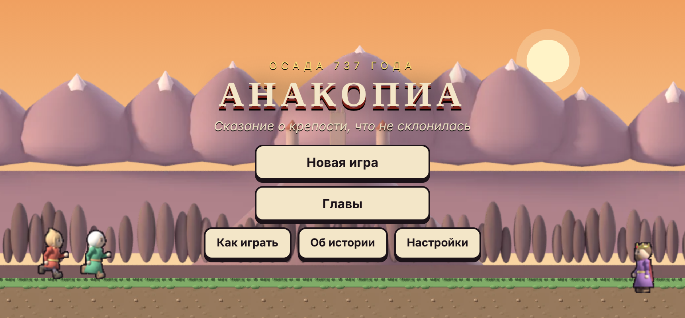
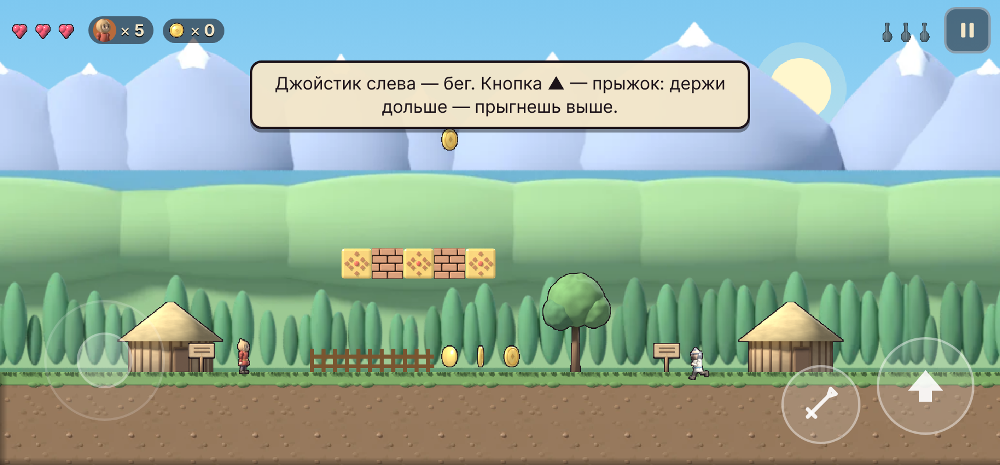
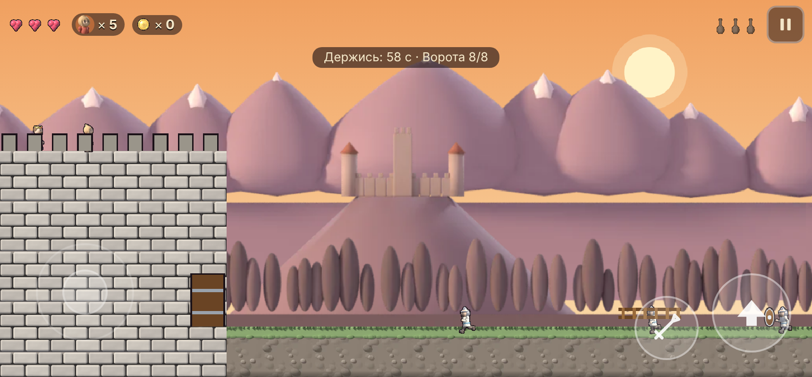
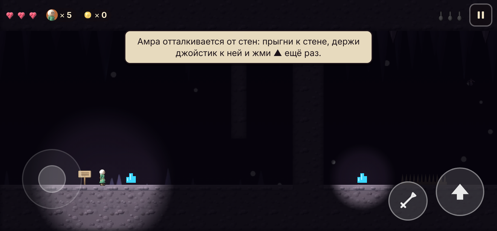
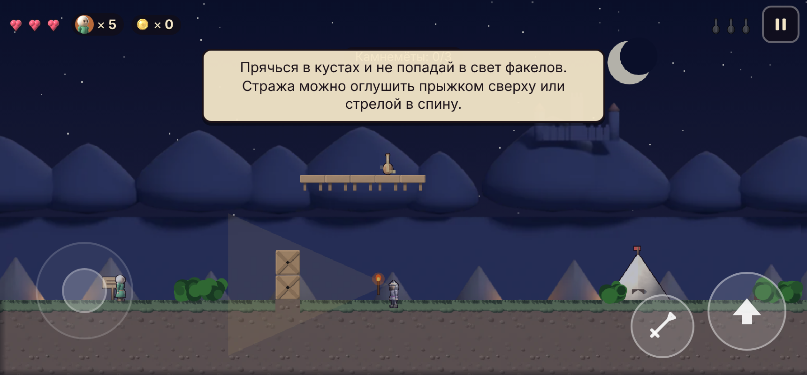
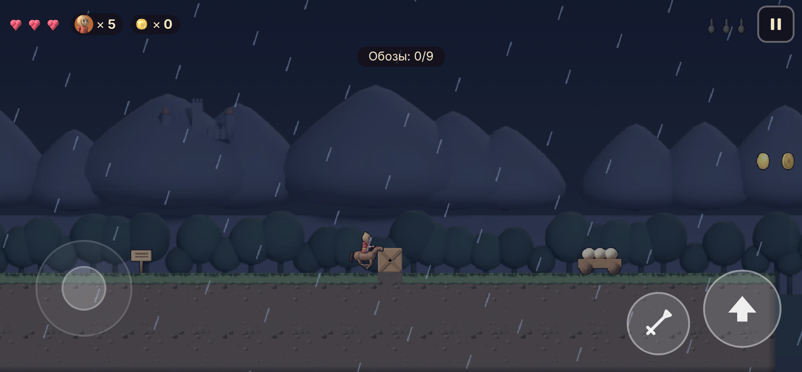
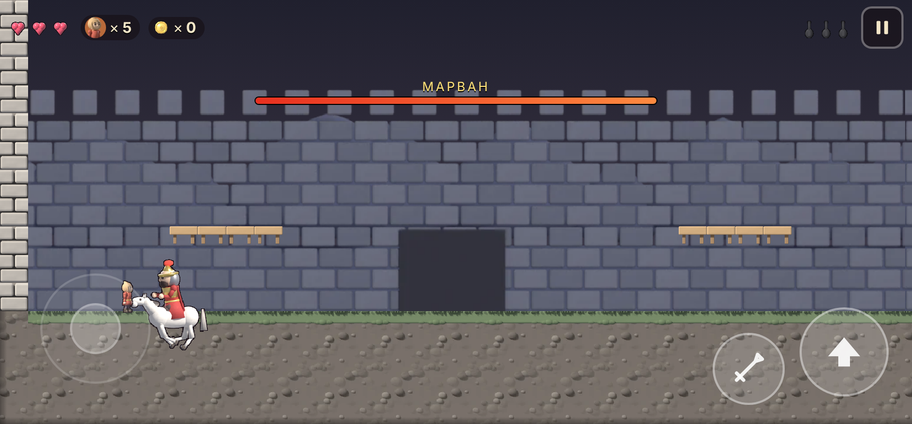

# Анакопиа — сказание о крепости, что не склонилась

Мобильная 2D-игра-платформер для Android об обороне абхазской крепости **Анакопиа** от войска Марвана (около 737 года). Девять глав, и в каждой своя механика: платформер, погоня, оборона стен, пещеры, стелс, скачка, подъём на осадную башню и финальный бой.

Только абхазские имена, места и образы: Аҧсны, Псырҵха, Аҟәа, Аҧсҳа Леон, Астамыр и Амра, Абнауаю, Аҩы, Шьашәы, Ажәеиҧшьаа, апхьарца, аџьыка.



| | |
|---|---|
|  |  |
|  |  |
|  |  |

## Скачать и установить

1. Скачайте **[`dist/anakopia.apk`](dist/anakopia.apk)** (≈ 1,1 МБ). Свежую сборку из официального Android SDK можно взять в артефактах GitHub Actions: workflow *Android APK* → *anakopia-apk*.
2. На телефоне разрешите установку из неизвестных источников (Настройки → Безопасность → «Установка неизвестных приложений» для браузера или файлового менеджера).
3. Откройте APK и установите. Нужен **Android 7.0+**, интернет не требуется.

> Сборки из `dist/` и из GitHub Actions подписаны разными ключами. Если ставите одну поверх другой, сначала удалите старую версию.

## Сюжет

Сказительница у очага берёт в руки апхьарцу с порванными струнами и поёт о 737 годе. Полководец Марван ведёт тысячи воинов через перевалы. Юноша **Астамыр** и его сестра, лучница **Амра**, несут весть правителю Аҧсны **Леону** в Анакопиа. Им предстоит пройти ущелье Псырҵха, уйти от лесного великана Абнауаю, отбить штурм, найти воду в пещерах под горой, сжечь вражеские камнемёты, разбить обоз, обрушить осадную башню и встретить самого Марвана у ворот. В конце сказительница раскрывает, кто она на самом деле.

## Главы

| № | Глава | Герой | Механика |
|---|-------|-------|----------|
| 1 | Дым над Псырҵха | Астамыр | Классический платформер, обучение, тайники, пружина-ветка |
| 2 | Ущелье Псырҵха | Астамыр | Плывущие и падающие брёвна, плавание, рыбы, лучники на скалах |
| 3 | Лес Абнауаю | Астамыр | Погоня с автопрокруткой: великан наступает слева |
| 4 | Стены Анакопии | Астамыр | Оборона: броски камней в точку касания, сброс лестниц, таран |
| 5 | Чрево горы | Амра | Темнота с факелом, прыжки от стен, сталактиты, летучие мыши |
| 6 | Лагерь Марвана | Амра | Стелс: конусы обзора стражи, кусты, поджог трёх камнемётов |
| 7 | Вылазка на Бзоу | Астамыр на коне | Скачка под дождём, сабля, разгром обозов |
| 8 | Осадная башня | Астамыр | Вертикальный подъём по лестницам, камнепад, Осадный мастер, канаты |
| 9 | Марван | Астамыр | Босс в трёх фазах: конная атака, пеший бой, гроза Аҩы |

## Управление

- **Джойстик** — любое место левой половины экрана: бег, лестницы вверх и вниз.
- **▲** — прыжок. Чем дольше держишь, тем выше. В воде кнопка помогает всплыть. Амра отталкивается от стен.
- **⚔** — у Астамыра меч, у Амры лук, с аџьыкой огненные броски. Этой же кнопкой поджигают камнемёты, а на стене бросают камни.
- **Касание поля** в главе 4 бросает камень в эту точку.
- **«Назад»** ставит игру на паузу. Пауза включается и при сворачивании приложения.
- На компьютере: стрелки или WASD, Пробел — прыжок, X — удар, Esc — пауза, Enter — дальше.

## Бонусы и секреты

- **Мёд Аҧсны** — +1 сердце (до 5).
- **Аџьыка** — огненные броски.
- **Щит Шьашәы** — неуязвимость.
- **Перо Аҩы** — гром, который поражает врагов на экране.
- **Огонь-маяк** — контрольная точка.
- **100 монет** — дополнительная жизнь.
- **3 струны апхьарцы** спрятаны в каждой главе, всего 27. Если собрать все, в финале звучит песня целиком.

## Графика

Персонажи, кони, звери, предметы, декорации (апацха, шатры, камнемёт, ворота), тайлы, фоновые пейзажи всех глав и портреты для диалогов — **3D-модели, собранные и отрендеренные в Blender** (Cycles) скриптами из `tools/blender/`. Затем рендеры сжимаются в атласы WebP с контурной обводкой. Игра рисует их в тройном внутреннем разрешении, а погода, свет факелов, частицы и оружие дорисовываются кодом.

```bash
pip install bpy
python3 tools/blender/build_assets.py
```

Скрипт пересобирает ассеты в `game/assets/` (около 6 минут на 4 ядрах).

## Для разработчиков

```
game/      — сама игра (HTML5 Canvas + Web Audio, без зависимостей); game/assets — рендеры из Blender
android/   — Android-проект (Gradle): полноэкранный WebView, игра берётся из game/ как assets
tools/     — сборка APK без SDK, Blender-скрипты ассетов, иконки, автотесты
dist/      — готовый APK
docs/      — скриншоты и дизайн-документ (с улучшенным промптом)
```

Игру можно открыть в браузере: `game/index.html` открывается двойным щелчком.

Автотесты используют Playwright и Chromium:

```bash
node tools/reach-test.js
```

`reach-test.js` проверяет проходимость каждой главы на настоящей физике героя: перебирает прыжки, шаги, лазание и прыжки от стен и находит путь к выходу, всем 27 струнам, камнемётам и канатам.

```bash
node tools/flow-test.js
```

`flow-test.js` — сквозной сценарий: меню, сказания, гибель и возрождение, сохранение, пауза, оборона с тараном, три фазы Марвана, стелс.

Сборка APK через Gradle (нужен Android SDK):

```bash
cd android && ./gradlew assembleRelease
```

Сборка APK без Android SDK (JDK, Python и три jar с Maven Central: `org.robolectric:android-all`, `com.jakewharton.android.repackaged:dalvik-dx`, `com.android.tools.build:apksig`):

```bash
python3 tools/build_apk.py --android-jar android-all.jar --dx-jar dalvik-dx.jar --apksig-jar apksig.jar
```

GitHub Actions (`.github/workflows/android.yml`) собирает APK официальным SDK, запускает его в эмуляторе Android и сохраняет скриншоты. Если запушить тег `v*`, workflow опубликует релиз с APK.

Для публикации в магазине замените `signingConfigs.debug` в `android/app/build.gradle` на свой ключ. Ключи в репозиторий не коммитьте.

## История

Около 737 года войско Марвана ибн Мухаммада осадило Анакопиа. Защитники во главе с Леоном выстояли, а осаждающие понесли тяжёлые потери от болезней и разливов рек и отступили. Игра — художественное сказание по мотивам этих событий. Астамыр, Амра и старейшина Даур вымышлены. Абнауаю, Аҩы, Шьашәы и Ажәеиҧшьаа — образы абхазской мифологии.
